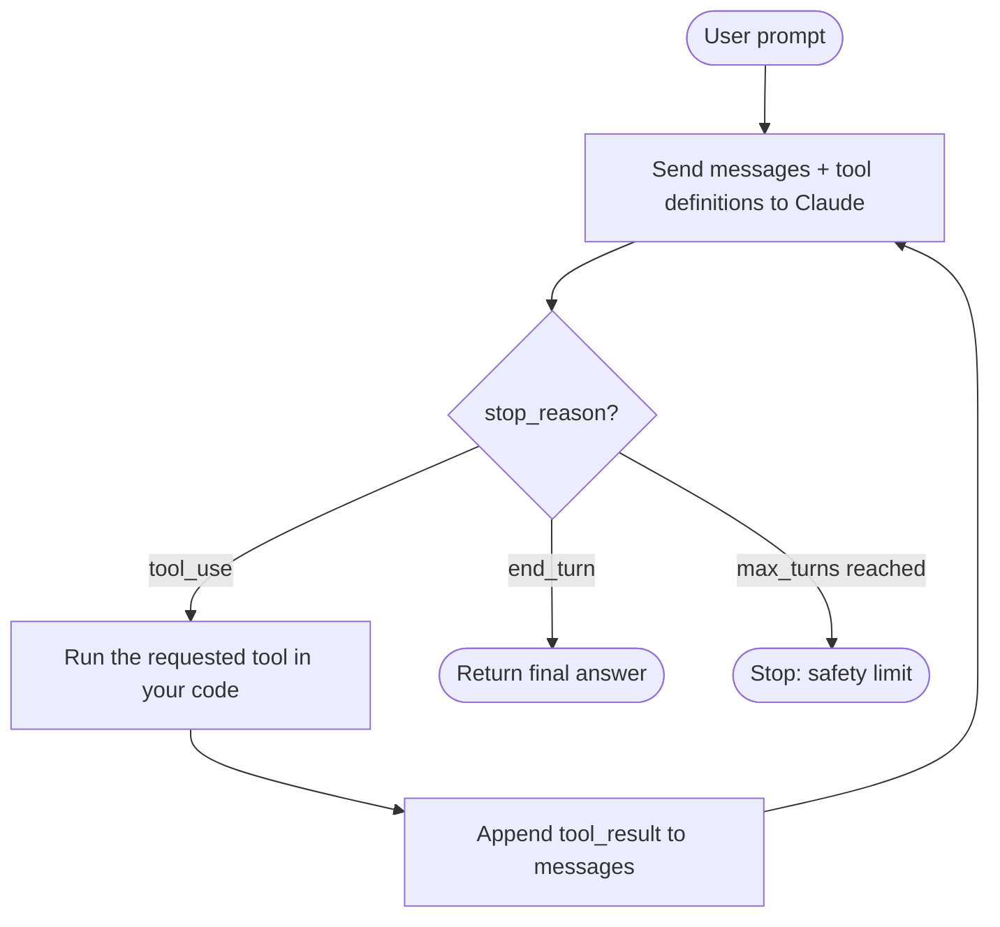

# Agent Loop 101

A hands-on intro to tool use with Claude. One file, about 100 lines, no frameworks.

#### The big idea

An "agent" is just a loop:

1. Send the messages and tool definitions to the model.
2. If the reply has `stop_reason == "tool_use"`, run the requested tool(s) yourself and send the output back as a
   `tool_result`.
3. Repeat until the model replies with `stop_reason == "end_turn"`.



#### Setup

Requires Python 3.11+ and [uv](https://docs.astral.sh/uv/).

```bash
uv add anthropic
export ANTHROPIC_API_KEY=sk-ant-...      # PowerShell: $env:ANTHROPIC_API_KEY="sk-ant-..."
```

#### Run

```bash
uv run agent_demo.py
uv run agent_demo.py "What is 1234 * 5678, and what's the weather in NYC?"
```

You'll see each tool call printed as the agent works, then the final answer.

#### How the code is organized

| Section                  | What it shows                                                                                                              |
|--------------------------|----------------------------------------------------------------------------------------------------------------------------|
| Tool definitions         | A name, a description, and a JSON Schema. The description acts as a prompt: the model decides when to call a tool from it. |
| Tool implementations     | Plain Python functions. `get_weather` returns fake data; swap in a real API.                                               |
| Agent loop (`run_agent`) | The loop above, with `max_turns` as a safety limit.                                                                        |

Two details worth noticing:

- **Tool errors go back to the model** as text, so it can recover or try something else instead of crashing the program.
- **The full assistant turn is appended to history**, including its `tool_use` blocks. The API needs this to match each
  `tool_result` to its request.

#### Limits of this demo

- `calculate` uses `eval` with a character allowlist. This is fine for a demo but not for production; use a real
  expression parser.
- `get_weather` is fake data.
- There is no streaming, retry logic, or token budgeting.

#### Exercises

1. Add a third tool, such as `search_notes(query)`, and watch the model choose it.
2. Break a tool on purpose (raise an exception) and see how the model recovers.
3. Add a system prompt with `system="..."` and see how behavior changes.
4. Stream the response with `client.messages.stream(...)` for live output.
5. Move the tools into an MCP server so any client can reuse them.